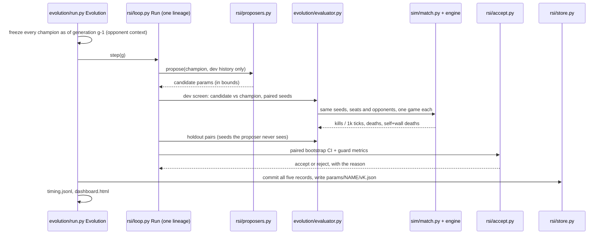

# Snake Arena RSI

Five AI snakes fight on a 100 × 100 grid. Each one is trying to make the others crash
into its body, because every kill is a point. Between games, each snake gets to
**improve itself**: it proposes a change to its own strategy, tests that change against
its rivals and against older versions of everyone, and keeps the change only if it
really wins more. Repeat that loop and you have a small, watchable lab for
**recursive self-improvement (RSI)**.

Five personalities play (Hunter, Survivor, Trapper, Predictor, Opportunist). A generic,
snake-agnostic improvement loop (`arena/rsi`) is proven on toy problems, and each snake
now runs its own lineage on that loop (`evolve`), with a report and a live dashboard.
In the specified experiment (given 10 generations, it stopped after 7 when no snake had
improved in 4), **one of the five snakes (Trapper)** **measurably improved itself**; the
other four found nothing that passed the tests (see
[Results](#results)).


## The game in one paragraph

Five snakes, each a fixed 5 cells long, move one cell per tick at the same time. Hit a
wall, yourself, or another snake and you die. If you die by running into another
snake's body, *that* snake gets a point. Head-on crashes kill both and award nothing.
Dead snakes respawn after 10 ticks and keep their score. First to 100 kills wins; a
100,000-tick cap ends matches that never get there.

## Quick start

Needs Python 3.12+ and [uv](https://docs.astral.sh/uv/). No other services or keys.

```bash
uv sync
```

**Watch a match in the browser** (opens http://127.0.0.1:8000/). It defaults to the
five personalities on a 20 × 20 board, first to 10 kills; every setting can be changed in
the page or with flags such as `--width 40 --target 25 --policy random_safe`.

```bash
uv run python -m arena.cli watch
```

**Simulate a full match headless** on the default 100 × 100 board, first to 100 kills,
capped at 100,000 ticks:

```bash
uv run python -m arena.cli run-match --seed 42
```

```text
Match seed 42: 100x100 board, 5 snakes x 5 cells, first to 100 kills, cap 100,000 ticks
Ended at tick 100,000 (tick_cap), winner s4

rank  snake  policy          kills deaths    K/D alive ticks
   1  s4     random_safe         2     20   0.10      99,780
   2  s0     random_safe         1     22   0.05      99,758
   ...
100,000 ticks in 3.65s (27,367 ticks/s)
```

**Run a tournament** of seeded matches over several processes (results don't depend on
the worker count), writing `matches.jsonl`, `summary.csv` and a 5 × 5 `kill_matrix.csv`:

```bash
uv run python -m arena.cli run-tournament --matches 100 --workers 4 --out out/tournament
```

**Save and replay** a match exactly:

```bash
uv run python -m arena.cli run-match --seed 7 --width 20 --height 20 --target 10 --replay out/m7.json
uv run python -m arena.cli watch --replay out/m7.json
```

**Browse stored games.** The viewer's replay library lists every replay file and every
tournament match under `out/` (or the folders given with `--library`). Filter by winner,
by a policy taking part, or by how the game ended, then click one to watch it. Replay
files play back their stored actions. Tournament rows are re-simulated from their seed,
config and policies, which gives the same game while the code and parameters are
unchanged. Pause on a moment and bookmark it; bookmarks are kept in
`out/bookmarks.json` and open paused at that tick.

```bash
uv run python -m arena.cli watch --library out
```

**Measure speed and kill rates,** or each personality's time per move:

```bash
uv run python -m arena.cli bench
```

```bash
uv run python -m arena.cli bench --policies all
```

**Check the personalities** against phase 2's acceptance criteria (seven
100-match tournaments of 5,000-tick episodes, so it takes a while). The last report is in
[`docs/phase-2-check.md`](docs/phase-2-check.md).

```bash
uv run python -m arena.cli check-personalities --workers 4
```

**Run the improvement loop on a toy problem** (a noisy 5-D quadratic with a known best).
It prints each generation's decision and writes a run directory (`config.json`,
`generations.jsonl`, `archive/`, `champion.json`, `report.md`) under `runs/`. Running the
same command again resumes the run; pass a larger `--generations` to extend it.

```bash
uv run python -m arena.cli rsi-demo --problem quadratic --generations 60
```

**Let the loop tune its own improver** (a meta-run). An outer loop proposes settings for
the default hill climber (initial step size, grow and shrink factors) and scores each by
running an inner loop with them on toy problems, then checks the settings it kept against
the defaults on toy problems no proposer saw. The committed run is in
[`experiments/2026-11-13-meta`](experiments/2026-11-13-meta/README.md).

```bash
uv run python -m arena.cli rsi-meta --workers 4 --generations 40 --pairs 30
```

**Let the snakes improve themselves.** Each of the five lineages proposes a change to
its own parameters every generation and keeps it only if paired games on held-out seeds
show a real gain without more deaths. `--quick` is a fast end-to-end check (about 8
minutes on 4 cores). `--profile experiment` is the reduced setting used for the
baseline, and the default profile is the full specified experiment (hours per
generation). Re-running the same command resumes the run. For long runs, `--max-hours H`
stops after the generation in which the run's total time, summed over resumes, reaches
H hours. `--max-episodes N` stops each lineage after N episodes. Creating a file named
`STOP` in the run directory stops the run after the current generation. Any of these
stops can be resumed later with a larger budget.

```bash
uv run python -m arena.cli evolve --quick --generations 3 --run-id demo
```

Each run keeps `runs/<id>/dashboard.html` up to date while it runs. Open it in a browser
to watch proposals, intervals, guard metrics and parameters change generation by
generation. `report` plays the untouched final seeds and writes `report.md`,
`progress.svg` and the dashboard. `watch --run` loads every archived champion into the
viewer (`--vs-generation 0` seats evolved and original versions in one game).

```bash
uv run python -m arena.cli report runs/demo
```

```bash
uv run python -m arena.cli watch --run runs/demo --vs-generation 0
```

**Run experiments from the browser.** `watch` also serves an experiments screen at
`/experiments` over `runs/` (or `--runs-dir`). It lists every run with its status,
starts or resumes one (run id, profile, generations, an hour cap, workers) as a separate
`evolve` process that keeps going if the viewer closes, and stops one by creating its
`STOP` file, so the run ends after its current generation. For a selected run it shows
each lineage's accepted versions on one chart, the champions' kill matrix, every
generation's decision and the log. It only starts the same command you could type, so it
can't change how runs are judged, and it can't pick the opt-in language-model proposer.
Runs started in a terminal show up too: `evolve` writes `runs/<id>.pid` while it runs.

```bash
uv run python -m arena.cli watch --runs-dir runs
```

**Query everything with SQL.** `index` reads every evolve run and tournament
`matches.jsonl` under the folders you give into one SQLite file (tables `runs`,
`agents`, `policy_versions`, `generations`, `candidate_evaluations`,
`promotion_decisions`, `matches`, `match_participants`, `kills`). The files stay the
record; re-running `index` replaces each source's rows, so it is safe while a run is
writing. `--sql` runs a read-only query, or open the file with any SQLite tool.

```bash
uv run python -m arena.cli index experiments runs out --db arena.db
```

```bash
uv run python -m arena.cli index --db arena.db --sql "SELECT run_id, agent, SUM(accept) FROM promotion_decisions GROUP BY 1, 2"
```

**Optional: a language-model proposer.** Nothing needs an API. If you want to try one,
`--proposer llm` (on `evolve` or `rsi-demo`) asks Claude for each candidate's numbers.
It sees only the parameter schema, the champion and recent dev-screen results, never a
seed. Its reply is clipped to the parameter bounds, every call is logged to
`llm_audit.jsonl`, and `--max-llm-tokens` / `--max-llm-dollars` stop the run when spent.
A failed or unusable reply falls back to the hill climber for that proposal. It needs
the `llm` extra and an `ANTHROPIC_API_KEY`. It has not yet been compared against the
default improver.

```bash
uv sync --extra llm
```

```bash
uv run python -m arena.cli evolve --quick --proposer llm --max-llm-dollars 2 --run-id llm
```

**Optional: code proposals, review only.** `propose-code` asks the model for a whole new
version of one snake's strategy file (`arena/agents/<snake>.py`), showing it the file,
the snake's parameters and, with `--run`, its lineage's dev-screen results (never holdout
numbers or seeds). The answer is checked with `ast` only (it parses, keeps the policy
name, imports only from an allowlist, avoids file, process and dynamic-code builtins) and
saved as `proposals/<snake>/<n>/patch.diff` with `REVIEW.md` and `audit.json`. Nothing
it writes is imported, run or applied: there is no sandbox here, and static checks are
not one, so promotion is manual (`git apply`, tests, an evolve run, then commit).

```bash
uv run python -m arena.cli propose-code hunter --run runs/demo --max-llm-dollars 1
```

`--policy` takes one policy for every snake (`random_safe`, `hunter`, …), a comma list
per snake, or the `personalities` lineup.

Run `uv run python -m arena.cli <command> --help` for every flag.

## Tests

```bash
uv run pytest
uv run ruff check . && uv run ruff format --check . && uv run mypy
```

The suite has golden tests for every collision rule, randomized invariant checks over
hundreds of seeds, determinism and replay checks, server API tests, and a headless
Chromium smoke test of the viewer (skipped when Node + Playwright aren't installed).

## Measured so far

On this project's cloud container (Python 3.13, x86_64, 4 cores; single process unless a row says otherwise):

| What | Result |
|---|---|
| Engine only, 100 × 100, 5 snakes | ~50,000 ticks/s in one process (median of 7 runs of 50,000 ticks) |
| Full match with `RandomSafe` policies | ~28,000–31,500 ticks/s in one process (median of 5 matches of 50,000 ticks: 31,622) |
| Total over 4 worker processes (`bench --workers 4 --ticks 50000`, 3 runs) | engine only 190,000–194,000 ticks/s; full `RandomSafe` matches 117,000–124,400 ticks/s. This meets the vision's 100,000 ticks/s with simple heuristic agents when the cores are used, as tournaments and `evolve` do; one process does not reach it |
| `RandomSafe` kills per 1,000 ticks, 100 × 100 (all snakes, 100 matches) | 0.049 |
| Default 100-match tournament (100 × 100, cap 100,000) | all 100 hit the cap; ~1 kill per snake per match; 10M ticks in 148 s on 4 workers; after the step rewrite, 20 matches ran at ~70,000 ticks/s on 4 workers |
| Median ticks to 10 kills, `RandomSafe`, 20 × 20 (8 seeds) | ~14,700 |
| Personality time per move, 100 × 100 (median / p99) | 0.21–0.42 ms / 0.41–0.82 ms |
| Each personality vs 4 × `RandomSafe`: kills per 1,000 ticks (100 matches) | Hunter 1.66, Predictor 1.73, Trapper 0.76, Survivor 0.24, Opportunist 0.15; `RandomSafe` ≤ 0.015 |
| Deaths per 1,000 alive ticks, all five personalities together | 0–0.034, vs 0.192 for `RandomSafe` |

| Improvement loop, 5-D noisy quadratic, 60 generations (10 seeds) | `gaussian_hill_climb` within 10% of the optimum on 10/10, `random_restart` on 0/10 |
| Improvement loop on pure noise (5 × 200 generations) | 14 accepts in 1,000 (1.4%) |
| Meta-run: hill-climb settings on toy quadratics (40 generations, 30 pairs, 4 workers, 6 min 52 s) | 2 accepts on holdout; kept σ 0.148, grow 1.47, shrink 0.902 (defaults 0.15, 1.5, 0.9). On 60 final toy problems: −4.506 vs −4.746, difference +0.240, 95% CI [−0.233, +0.806], so **no measurable gain**: the defaults were already about as good |

Random snakes almost never kill on the full board, so default matches end at the tick
cap. The personalities kill random snakes far more often, but against each other they are
careful enough that in 4 all-five matches on 100 × 100, all 4 reached the 100,000-tick
cap with 1 kill between them. Phase 4 therefore adds a labelled, reduced `experiment`
profile (24 × 24, 2,000-tick episodes) where snakes meet often enough to measure.

## Results

Two phase 4 runs are committed, each with a README, report and dashboard (download
`dashboard.html` and open it in a browser):

| Run | Setting | Generations | Lineages improved on final seeds |
|---|---|---|---|
| [`2026-11-12-default`](experiments/2026-11-12-default/README.md) | the specified default profile: 100 × 100, 5,000-tick episodes, 100 + 100 pairs | 7 of 10 (all stopped on patience) | **1 of 5**: Trapper, +0.053 kills / 1k ticks, 95% CI [+0.024, +0.087] |
| [`2026-11-12-baseline`](experiments/2026-11-12-baseline/README.md) | reduced experiment profile: 24 × 24, 2,000-tick episodes, 40 + 40 pairs | 4 (all stopped on patience) | 0 of 5 |

In the default run, **Trapper** accepted one change in generation 3: it keeps closer to
rivals (`keep_distance 3 -> 2`, `w_space 6 -> 4.897`). That doubled its kills on the
holdout seeds while its deaths per alive tick halved. The gain held on the untouched final
seeds and against the hand-set reference snakes, and the hall-of-fame check shows no
cycle. The other four lineages accepted nothing, and generations 4-7 found nothing more for any
lineage. Several proposals looked better but had
intervals reaching zero, and one Opportunist change that bought kills with self-crashes
was stopped by the death guard.

The smaller baseline proposed the very same Trapper change but could not tell it from
noise with 40 holdout pairs. Kills are rare, so this experiment needs many paired games.
Both results come from protocols fixed in advance and are reported as they came out.

## System design

This section is the map of the code for people and coding agents. It is kept in sync by
a test (`tests/test_docs.py`) that fails when a module under `arena/` is missing from the
diagram, and agents are asked to improve it whenever they find it unclear or stale (see
[`AGENTS.md`](AGENTS.md)). Arrows point from a module to what it uses or produces. The engine, agents, sim and
viz use only the standard library; `arena/rsi` uses NumPy and never imports the snake
code.

```mermaid
flowchart TB
  subgraph ENGINE["arena/engine: pure rules"]
    types["engine/types.py<br/>GameConfig · GameState · events<br/>frozen, JSON round-trip"]
    rng["engine/rng.py<br/>SplitMix64 · derive_seed"]
    spawn["engine/spawn.py<br/>seeded spawn + fallback scan"]
    step["engine/step.py<br/>new_game · step · rank"]
    step --> spawn --> rng
    step --> types
  end

  subgraph AGENTS["arena/agents: policies"]
    base["agents/base.py<br/>Policy · Observation · legal_moves"]
    randp["agents/random_policies.py<br/>RandomSafe · RandomUniform"]
    features["agents/features.py<br/>Board + shared move features"]
    params["agents/params.py<br/>ParamSpace bounds · load/save"]
    pjson[("agents/params/*.json<br/>hand-set weights")]
    scorer["agents/scorer.py<br/>ScoringPolicy: weighted feature sum"]
    pers["agents/hunter.py · agents/survivor.py · agents/trapper.py<br/>agents/predictor.py · agents/opportunist.py"]
    registry["agents/registry.py<br/>POLICIES · LINEUPS · STYLES"]
    randp --> base
    scorer --> features --> base
    scorer --> params --> pjson
    pers --> scorer
    registry --> pers
    registry --> randp
  end

  subgraph SIM["arena/sim: headless games"]
    match["sim/match.py<br/>Match: policies x engine, fallbacks"]
    replay["sim/replay.py<br/>save / load / verify"]
    tournament["sim/tournament.py<br/>seeded matches over processes"]
    stats["sim/stats.py<br/>summaries · kill matrix"]
    metrics["sim/metrics.py<br/>behaviour metrics"]
    bench["sim/bench.py<br/>speed · kill rates · move times"]
    boards["sim/boards.py<br/>named board configs"]
    pcheck["sim/personality_check.py<br/>phase 2 acceptance · episode_config"]
    tournament --> match
    tournament --> stats
    replay --> match
    bench --> match
    pcheck --> tournament
    pcheck --> metrics
  end

  subgraph VIZ["arena/viz: viewer"]
    server["viz/server.py<br/>Session · App · Roster<br/>frames pulled on demand"]
    static["viz/static/index.html · app.js · style.css<br/>Canvas page · replay library · bookmarks<br/>experiments.html · experiments.js"]
    library["viz/library.py<br/>indexes replay files + tournament matches.jsonl<br/>filters · bookmarks.json (reindex on mtime)"]
    experiments["viz/experiments.py<br/>lists, inspects, starts, stops evolve runs<br/>start = evolve subprocess · stop = STOP file"]
    static -- "/api/match/:id/frames" --> server
    static -- "/api/library · /api/bookmarks" --> server
    static -- "/api/runs (POSTs must be JSON)" --> server
    server --> library
    server --> experiments
  end

  subgraph RSI["arena/rsi: generic loop"]
    rtypes["rsi/types.py<br/>ParamSpec · Candidate · PairedResult<br/>Evaluator / Proposer / AcceptanceRule protocols"]
    seeds["rsi/seeds.py<br/>disjoint dev / holdout / final pools"]
    proposers["rsi/proposers.py<br/>random restart · hill climb · coordinate<br/>cross-entropy · archive crossover · pbt (dev results only)"]
    accept["rsi/accept.py<br/>PairedBootstrapRule + guards"]
    loop["rsi/loop.py<br/>Run: propose → dev screen → holdout → decide"]
    store["rsi/store.py<br/>run dir · atomic writes · immutable archive"]
    rreport["rsi/report.py<br/>toy-run report.md"]
    toys["rsi/toys.py<br/>noisy quadratic · pure noise · test evaluators"]
    llm["rsi/llm.py<br/>optional LLMProposer: numbers only, clipped,<br/>token/dollar budget, llm_audit.jsonl,<br/>falls back to hill climb"]
    loop --> proposers
    meta["rsi/meta.py<br/>meta-run: an outer Run tunes the hill climb's<br/>sigma · grow · shrink; each score = an inner Run on a toy"]
    meta --> loop
    meta --> toys
    mapel["rsi/map_elites.py<br/>MAP-Elites archive over a behaviour grid<br/>dev seeds for search · holdout re-score at the end"]
    mapel --> proposers
    mapel --> seeds
    mapel --> store
    proposers -. "--proposer llm (lazy)" .-> llm
    llm --> proposers
    loop -- "spent() vs Budget.tokens / dollars" --> llm
    loop --> accept
    loop --> seeds
    loop --> store
    loop --> rtypes
    toys --> rtypes
    rreport --> store
  end

  subgraph EVO["arena/evolution: snake lineages"]
    entrants["evolution/entrants.py<br/>Entrant = policy + params + version"]
    evaluator["evolution/evaluator.py<br/>SnakeEvaluator: paired episodes<br/>opponent mixture · Workers pool"]
    run["evolution/run.py<br/>Profiles · Lineage · Evolution (lockstep)"]
    ereport["evolution/report.py<br/>final seeds · cycle check · progress.svg"]
    dashboard["evolution/dashboard.py<br/>live dashboard.html"]
    watch["evolution/watch.py<br/>archived champions as a viewer Roster"]
    codeprop["evolution/code_proposer.py<br/>opt-in, review-only: LLM proposes a strategy file;<br/>ast checks + patch.diff; never imported, run or applied"]
    run --> evaluator --> entrants
    run --> entrants
    ereport --> evaluator
    dashboard --> ereport
    watch --> ereport
    emap["evolution/map_elites.py<br/>one personality: kills vs aggression x caution<br/>vs hand-set reference · heatmap SVG"]
    emap --> evaluator
  end

  cli["cli.py + __main__.py<br/>run-match · run-tournament · bench · watch<br/>check-personalities · rsi-demo · rsi-meta · evolve · report<br/>dashboard · propose-code · index · map-elites"]

  storage["storage/db.py<br/>SQLite index: runs · agents · policy_versions · generations<br/>candidate_evaluations · promotion_decisions · matches · kills<br/>rebuilt from the files, read-only queries"]
  OUT[("out/<br/>tournament matches.jsonl · summary.csv · kill_matrix.csv<br/>replay *.json · bookmarks.json")]
  RUNS[("runs/&lt;id&gt;/<br/>evolution.json · lineages/&lt;name&gt;/generations.jsonl<br/>params/&lt;name&gt;/v&lt;k&gt;.json · timing.jsonl<br/>report.md · progress.svg · dashboard.html<br/>map-elites-&lt;snake&gt;: map_elites.json · holdout.json · .svg")]

  AGENTS --> ENGINE
  match --> step
  match --> registry
  server --> match
  server --> registry
  library -- "load_replay" --> replay
  library -. "reads out/**/matches.jsonl, *.json replays" .-> OUT
  experiments -. "reads run files; writes STOP, &lt;id&gt;.pid, &lt;id&gt;.log" .-> RUNS
  experiments -. "python -m arena.cli evolve" .-> cli
  entrants --> registry
  evaluator --> match
  evaluator --> pcheck
  run -- "one Run per lineage" --> loop
  emap -- "MapElites" --> mapel
  emap --> metrics
  evaluator -. "implements Evaluator" .-> rtypes
  ereport --> accept
  watch -- "Roster" --> server
  run --> RUNS
  store --> RUNS
  ereport --> RUNS
  dashboard --> RUNS
  mapel --> RUNS
  codeprop -. "dev results only" .-> RUNS
  storage -. "reads" .-> RUNS
  storage -. "reads matches.jsonl" .-> OUT
  codeprop -- "Complete, prices" --> llm
  cli --> SIM
  cli --> VIZ
  cli --> RSI
  cli --> EVO
```

<!-- system-design:start -->


One generation of `evolve` (phase 4), for each of the five lineages in a fixed order:


<!-- system-design:end -->

The viewer and the CLI use the same engine, so a seed plays out identically in both.

## The four phases

1. **Arena** ✅ — a correct, deterministic engine with a fast headless simulation mode and
   a visualization mode. The snakes move randomly (safely).
2. **Personalities** ✅ — each snake gets its own objective: Hunter, Survivor, Trapper,
   Predictor, Opportunist.
3. **RSI framework** ✅ — a generic propose → test → keep-or-reject loop that knows nothing
   about snakes, with honest statistics, held-out tests, and a hall of fame.
4. **Snakes that improve themselves** ✅ (one of five improved in the specified run) —
   each snake plugs into the framework and tunes its own parameters, generation after
   generation, with a report, a live dashboard and an evolved-vs-original viewer.

## Read more

- [`specs/`](specs/README.md) — the full specification, one file per phase.
- [`specs/plan.md`](specs/plan.md) — the step-by-step build plan with targets.
- [`specs/rsi/`](specs/rsi/README.md) — RSI explained simply, with examples a high
  schooler can follow.
- [`AGENTS.md`](AGENTS.md) — rules for coding agents working in this repo.

## Limitations

- Improvement is slow and expensive: kills are rare, so each decision needs hundreds of
  5,000-tick games (36-54 minutes per generation on 4 cores while all five lineages are
  active; 3.3 hours for the whole run), and only one of five lineages improved. A local
  parameter search with patience 4 runs out of ideas quickly here.
- The improver tunes parameters only. It never edits code, as `specs/vision.md`
  requires until a real sandbox exists.
- The viewer is a local development tool (no auth); it binds to 127.0.0.1 by default.
- The opt-in per-move time budget uses wall-clock time, so it's off by default to keep
  headless runs deterministic.
