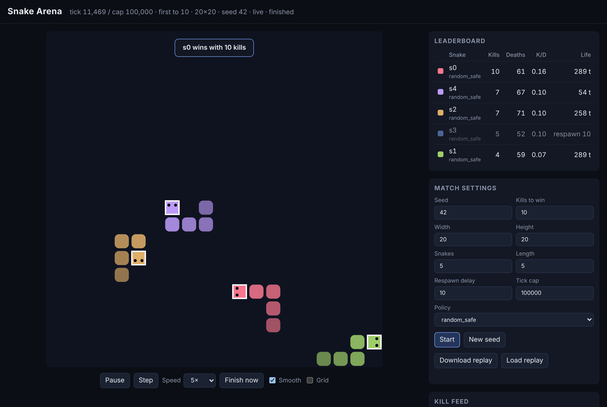

# Snake Arena RSI

Five AI snakes fight on a 100 × 100 grid. Each one is trying to make the others crash
into its body, because every kill is a point. Between games, each snake gets to
**improve itself**: it proposes a change to its own strategy, tests that change against
its rivals and against older versions of everyone, and keeps the change only if it
really wins more. Repeat that loop and you have a small, watchable lab for
**recursive self-improvement (RSI)**.



## The game in one paragraph

Five snakes, each a fixed 5 cells long, move one cell per tick at the same time. Hit a
wall, yourself, or another snake and you die. If you die by running into another
snake's body, *that* snake gets a point. Head-on crashes kill both and award nothing.
Dead snakes respawn after 10 ticks and keep their score. First to 100 kills wins; a
100,000-tick cap ends matches that never get there.

## Quick start

Needs Python 3.12+ and [uv](https://docs.astral.sh/uv/). No other services or keys.

```bash
uv sync
```

**Watch a match in the browser** (opens http://127.0.0.1:8000/). It defaults to a
20 × 20 board and first to 10 kills; every setting can be changed in the page or with
flags such as `--width 40 --target 25`.

```bash
uv run python -m arena.cli watch
```

**Simulate a full match headless** on the default 100 × 100 board, first to 100 kills,
capped at 100,000 ticks:

```bash
uv run python -m arena.cli run-match --seed 42
```

```text
Match seed 42: 100x100 board, 5 snakes x 5 cells, first to 100 kills, cap 100,000 ticks
Ended at tick 100,000 (tick_cap), winner s4

rank  snake  policy          kills deaths    K/D alive ticks
   1  s4     random_safe         2     20   0.10      99,780
   2  s0     random_safe         1     22   0.05      99,758
   ...
100,000 ticks in 5.54s (18,058 ticks/s)
```

**Run a tournament** of seeded matches over several processes (results don't depend on
the worker count), writing `matches.jsonl`, `summary.csv` and a 5 × 5 `kill_matrix.csv`:

```bash
uv run python -m arena.cli run-tournament --matches 100 --workers 4 --out out/tournament
```

**Save and replay** a match exactly:

```bash
uv run python -m arena.cli run-match --seed 7 --width 20 --height 20 --target 10 --replay out/m7.json
uv run python -m arena.cli watch --replay out/m7.json
```

**Measure speed and kill rates:**

```bash
uv run python -m arena.cli bench
```

Run `uv run python -m arena.cli <command> --help` for every flag.

## Tests

```bash
uv run pytest
uv run ruff check . && uv run ruff format --check . && uv run mypy
```

The suite has golden tests for every collision rule, randomized invariant checks over
hundreds of seeds, determinism and replay checks, server API tests, and a headless
Chromium smoke test of the viewer (skipped when Node + Playwright aren't installed).

## Measured so far

On this project's cloud container (Python 3.13, x86_64, single process):

| What | Result |
|---|---|
| Engine only, 100 × 100, 5 snakes | ~34,700 ticks/s |
| Full match with `RandomSafe` policies | ~18,000 ticks/s (a 100,000-tick match in ~5.5 s) |
| `RandomSafe` kills per 1,000 ticks, 100 × 100 (all snakes) | 0.02 |
| Median ticks to 10 kills, `RandomSafe`, 20 × 20 (8 seeds) | ~14,700 |

Random snakes almost never kill on the full board, so default matches end at the tick
cap. That's expected for phase 1 and is the baseline phase 2's personalities must beat.

## Architecture

```
            ┌──────────────────────── arena/engine ────────────────────────┐
            │ types · rng (SplitMix64) · spawn · step(state, actions)       │
            │ pure, deterministic, no I/O                                   │
            └───────────────▲───────────────────────────▲──────────────────┘
                            │                           │
   arena/agents ──► arena/sim/match.py (Match) ──► replay.py, tournament.py, bench.py
   Policy, RandomSafe,          │                           │
   RandomUniform                ▼                           ▼
                      arena/viz/server.py          arena/cli.py
                      (stdlib HTTP, frames         run-match · run-tournament
                       pulled on demand)           bench · watch
                                ▼
                      arena/viz/static (Canvas page)
```

The viewer and the CLI use the same engine, so a seed plays out identically in both.

## The four phases

1. **Arena** ✅ — a correct, deterministic engine with a fast headless simulation mode and
   a visualization mode. The snakes move randomly (safely).
2. **Personalities** — each snake gets its own objective: Hunter, Survivor, Trapper,
   Predictor, Opportunist.
3. **RSI framework** — a generic propose → test → keep-or-reject loop that knows nothing
   about snakes, with honest statistics, held-out tests, and a hall of fame.
4. **Snakes that improve themselves** — each snake plugs into the framework and tunes its
   own parameters, generation after generation.

## Read more

- [`specs/`](specs/README.md) — the full specification, one file per phase.
- [`specs/plan.md`](specs/plan.md) — the step-by-step build plan with targets.
- [`specs/rsi/`](specs/rsi/README.md) — RSI explained simply, with examples a high
  schooler can follow.
- [`AGENTS.md`](AGENTS.md) — rules for coding agents working in this repo.

## Limitations

- Phase 1 only: snakes are random; no personalities or self-improvement yet.
- The viewer is a local development tool (no auth); it binds to 127.0.0.1 by default.
- The opt-in per-move time budget uses wall-clock time, so it's off by default to keep
  headless runs deterministic.
