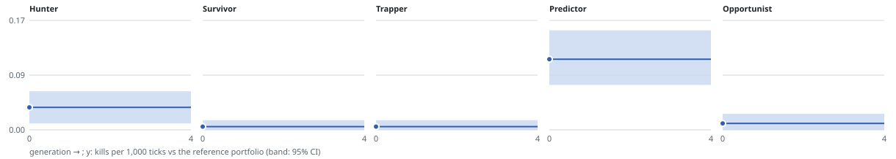

# Phase 4 report: 2026-11-12-experiment

Profile `experiment` — **experiment profile: a reduced setting, not the specified experiment**. 24 x 24 board, 2,000-tick episodes, 40 dev + 40 holdout pairs per candidate, proposer `gaussian_hill_climb`, min gain 2%, patience 4. Stopped after generation 4 (every lineage stopped).

All numbers below are on each lineage's final seeds, which no decision saw.

## Did each snake improve? (evolved champion vs its generation-0 self)

Paired games on the final seeds against the run's opponent mixture; kills per 1,000 ticks.

| snake | accepted | champion | evolved | gen 0 | difference | 95% CI | verdict |
|---|---|---|---|---|---|---|---|
| Hunter | 0 | v1 | - | - | - | - | no change (nothing accepted) |
| Survivor | 0 | v1 | - | - | - | - | no change (nothing accepted) |
| Trapper | 0 | v1 | - | - | - | - | no change (nothing accepted) |
| Predictor | 0 | v1 | - | - | - | - | no change (nothing accepted) |
| Opportunist | 0 | v1 | - | - | - | - | no change (nothing accepted) |

## Progress against the reference portfolio

Each champion version in its seat against the four hand-set personalities.

| snake | version | from generation | kills/1k | 95% CI | deaths/episode | enemy distance | space |
|---|---|---|---|---|---|---|---|
| Hunter | v1 | 0 | 0.035 | [+0.010, +0.060] | 0.35 | 4.30 | 69.06 |
| Survivor | v1 | 0 | 0.005 | [+0.000, +0.015] | 0.03 | 4.36 | 72.55 |
| Trapper | v1 | 0 | 0.005 | [+0.000, +0.015] | 0.19 | 4.45 | 69.09 |
| Predictor | v1 | 0 | 0.110 | [+0.070, +0.155] | 0.22 | 4.32 | 69.58 |
| Opportunist | v1 | 0 | 0.010 | [+0.000, +0.025] | 0.09 | 4.72 | 68.71 |

## Hall-of-fame check

Each final champion against every earlier version of itself, paired, with opponents drawn from all lineages' halls of fame. A negative interval would mean a later version lost to an earlier one (a cycle).

No lineage has more than one version, so there is nothing to check.

## Kill matrix of the final champions (100 episodes of 2,000 ticks)

Rows killed columns.

| killer \ victim | Hunter v1 | Survivor v1 | Trapper v1 | Predictor v1 | Opportunist v1 |
|---|---|---|---|---|---|
| Hunter v1 | 0 | 0 | 1 | 5 | 0 |
| Survivor v1 | 1 | 0 | 0 | 0 | 0 |
| Trapper v1 | 4 | 0 | 0 | 1 | 0 |
| Predictor v1 | 20 | 1 | 0 | 0 | 0 |
| Opportunist v1 | 0 | 0 | 0 | 0 | 0 |

## Decision log

### Hunter

| gen | change | dev diff | holdout diff | holdout CI | decision |
|---|---|---|---|---|---|
| 1 | w_space_vs_length 20->102.7 | +0.000 | - | - | reject: dev mean difference +0 is not above 0 |
| 2 | w_territory 20->-23.34 | +0.125 | +0.056 | [-0.062, +0.175] | reject: holdout gain +12.3%, 95% CI [-0.0625, +0.175]: interval reaches 0 |
| 3 | pull_radius 0->11 | -0.050 | - | - | reject: dev mean difference -0.05 is not above 0 |
| 4 | trap_margin 2->2.51, keep_distance 1->0 | +0.000 | - | - | reject: dev mean difference +0 is not above 0 |

### Survivor

| gen | change | dev diff | holdout diff | holdout CI | decision |
|---|---|---|---|---|---|
| 1 | space_cap 60->46, w_space 20->-3.064 | +0.037 | -0.062 | [-0.188, +0.025] | reject: holdout gain -50.0%, 95% CI [-0.1875, +0.025]: below the 2% minimum gain |
| 2 | space_cap 60->18, trap_margin 2->1.595 | +0.113 | -0.037 | [-0.113, +0.050] | reject: holdout gain -30.0%, 95% CI [-0.1125, +0.05]: below the 2% minimum gain |
| 3 | trap_margin 2->2.358, w_nearest_enemy_head -8->-34.39 | +0.013 | -0.075 | [-0.163, +0.000] | reject: holdout gain -60.0%, 95% CI [-0.1625, +0]: below the 2% minimum gain |
| 4 | w_immediate_death -1000->-249.3, w_space 20->4.535 | +0.000 | - | - | reject: dev mean difference +0 is not above 0 |

### Trapper

| gen | change | dev diff | holdout diff | holdout CI | decision |
|---|---|---|---|---|---|
| 1 | w_enemy_space_after -15->-77.33 | -0.025 | - | - | reject: dev mean difference -0.025 is not above 0 |
| 2 | keep_distance 3->2, w_enemy_escape_moves -10->42.62, w_straightness 0.01->-2.235 | +0.100 | -0.013 | [-0.163, +0.125] | reject: holdout gain -6.3%, 95% CI [-0.1625, +0.125]: below the 2% minimum gain |
| 3 | keep_distance 3->2, w_space 6->4.897 | +0.100 | +0.000 | [-0.100, +0.100] | reject: holdout gain +0.0%, 95% CI [-0.1, +0.1]: below the 2% minimum gain |
| 4 | search_radius 12->11, w_space 6->-15.32 | +0.000 | - | - | reject: dev mean difference +0 is not above 0 |

### Predictor

| gen | change | dev diff | holdout diff | holdout CI | decision |
|---|---|---|---|---|---|
| 1 | w_space 6->103.5 | +0.025 | -0.025 | [-0.100, +0.050] | reject: holdout gain -4.3%, 95% CI [-0.1, +0.05]: below the 2% minimum gain |
| 2 | w_territory 20->-20.4, w_nearest_enemy_head -20->-34.77 | -0.050 | - | - | reject: dev mean difference -0.05 is not above 0 |
| 3 | w_expected_kills 300->571.5 | +0.013 | -0.025 | [-0.075, +0.000] | reject: holdout gain -4.3%, 95% CI [-0.075, +0]: below the 2% minimum gain |
| 4 | space_cap 60->59, w_straightness 0.01->-1.448 | -0.237 | - | - | reject: dev mean difference -0.2375 is not above 0 |

### Opportunist

| gen | change | dev diff | holdout diff | holdout CI | decision |
|---|---|---|---|---|---|
| 1 | trap_margin 2->3.475, cruise_straightness 0.01->-23.29 | +0.050 | +0.000 | [-0.037, +0.037] | reject: holdout gain +0.0%, 95% CI [-0.0375, +0.0375]: below the 2% minimum gain |
| 2 | attack_enemy_escape_moves -20->-80.18 | +0.000 | - | - | reject: dev mean difference +0 is not above 0 |
| 3 | trap_margin 2->1.292, pull_radius 15->0 | -0.013 | - | - | reject: dev mean difference -0.0125 is not above 0 |
| 4 | keep_distance 4->6, cruise_straightness 0.01->-22.27, attack_space_vs_length 20->23.8 | -0.037 | - | - | reject: dev mean difference -0.0375 is not above 0 |

