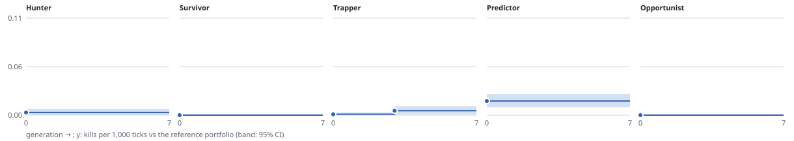

# Phase 4 report: 2026-11-12-default

Profile `default`. 100 x 100 board, 5,000-tick episodes, 100 dev + 100 holdout pairs per candidate, proposer `gaussian_hill_climb`, min gain 2%, patience 4. Stopped after generation 3 (generation budget).

All numbers below are on each lineage's final seeds, which no decision saw.

## Did each snake improve? (evolved champion vs its generation-0 self)

Paired games on the final seeds against the run's opponent mixture; kills per 1,000 ticks.

| snake | accepted | champion | evolved | gen 0 | difference | 95% CI | verdict |
|---|---|---|---|---|---|---|---|
| Hunter | 0 | v1 | - | - | - | - | no change (nothing accepted) |
| Survivor | 0 | v1 | - | - | - | - | no change (nothing accepted) |
| Trapper | 1 | v2 | 0.128 | 0.075 | +0.053 | [+0.024, +0.087] | improved |
| Predictor | 0 | v1 | - | - | - | - | no change (nothing accepted) |
| Opportunist | 0 | v1 | - | - | - | - | no change (nothing accepted) |

## Progress against the reference portfolio

Each champion version in its seat against the four hand-set personalities.

| snake | version | from generation | kills/1k | 95% CI | deaths/episode | enemy distance | space |
|---|---|---|---|---|---|---|---|
| Hunter | v1 | 0 | 0.003 | [+0.000, +0.007] | 0.01 | 4.98 | 73.20 |
| Survivor | v1 | 0 | 0.000 | [+0.000, +0.000] | 0.00 | 7.53 | 76.32 |
| Trapper | v1 | 0 | 0.001 | [+0.000, +0.003] | 0.09 | 12.28 | 69.96 |
| Trapper | v2 | 3 | 0.005 | [+0.001, +0.010] | 0.10 | 12.99 | 69.34 |
| Predictor | v1 | 0 | 0.016 | [+0.009, +0.024] | 0.07 | 12.21 | 70.34 |
| Opportunist | v1 | 0 | 0.000 | [+0.000, +0.000] | 0.14 | 9.97 | 69.61 |

## Hall-of-fame check

Each final champion against every earlier version of itself, paired, with opponents drawn from all lineages' halls of fame. A negative interval would mean a later version lost to an earlier one (a cycle).

| snake | final | versus | difference | 95% CI |
|---|---|---|---|---|
| Trapper | v2 | v1 | +0.004 | [+0.000, +0.009] |

## Kill matrix of the final champions (200 episodes of 5,000 ticks)

Rows killed columns.

| killer \ victim | Hunter v1 | Survivor v1 | Trapper v2 | Predictor v1 | Opportunist v1 |
|---|---|---|---|---|---|
| Hunter v1 | 0 | 0 | 0 | 2 | 1 |
| Survivor v1 | 0 | 0 | 0 | 0 | 0 |
| Trapper v2 | 5 | 0 | 0 | 1 | 0 |
| Predictor v1 | 8 | 0 | 1 | 0 | 2 |
| Opportunist v1 | 0 | 0 | 0 | 0 | 0 |

## Decision log

### Hunter

| gen | change | dev diff | holdout diff | holdout CI | decision |
|---|---|---|---|---|---|
| 1 | w_space_vs_length 20->102.7 | +0.000 | - | - | reject: dev mean difference +0 is not above 0 |
| 2 | w_territory 20->-23.34 | -0.062 | - | - | reject: dev mean difference -0.062 is not above 0 |
| 3 | pull_radius 0->11 | -0.004 | - | - | reject: dev mean difference -0.004 is not above 0 |

### Survivor

| gen | change | dev diff | holdout diff | holdout CI | decision |
|---|---|---|---|---|---|
| 1 | space_cap 60->46, w_space 20->-3.064 | -0.010 | - | - | reject: dev mean difference -0.01 is not above 0 |
| 2 | space_cap 60->18, trap_margin 2->1.595 | +0.026 | -0.004 | [-0.022, +0.012] | reject: holdout gain -12.5%, 95% CI [-0.022, +0.012]: below the 2% minimum gain |
| 3 | trap_margin 2->2.358, w_nearest_enemy_head -8->-34.39 | +0.000 | - | - | reject: dev mean difference +0 is not above 0 |

### Trapper

| gen | change | dev diff | holdout diff | holdout CI | decision |
|---|---|---|---|---|---|
| 1 | w_enemy_space_after -15->-77.33 | -0.008 | - | - | reject: dev mean difference -0.008 is not above 0 |
| 2 | keep_distance 3->2, w_enemy_escape_moves -10->42.62, w_straightness 0.01->-2.235 | +0.024 | +0.016 | [-0.003, +0.035] | reject: holdout gain +22.9%, 95% CI [-0.003, +0.035]: interval reaches 0 |
| 3 | keep_distance 3->2, w_space 6->4.897 | +0.052 | +0.072 | [+0.026, +0.130] | **accept**: accepted: holdout gain +100.0%, 95% CI [+0.026, +0.13] |

### Predictor

| gen | change | dev diff | holdout diff | holdout CI | decision |
|---|---|---|---|---|---|
| 1 | w_space 6->103.5 | +0.024 | +0.018 | [-0.018, +0.055] | reject: holdout gain +7.3%, 95% CI [-0.018, +0.055]: interval reaches 0 |
| 2 | w_territory 20->-20.4, w_nearest_enemy_head -20->-34.77 | -0.046 | - | - | reject: dev mean difference -0.046 is not above 0 |
| 3 | w_expected_kills 300->571.5 | +0.000 | - | - | reject: dev mean difference +0 is not above 0 |

### Opportunist

| gen | change | dev diff | holdout diff | holdout CI | decision |
|---|---|---|---|---|---|
| 1 | trap_margin 2->3.475, cruise_straightness 0.01->-23.29 | +0.008 | +0.030 | [+0.012, +0.050] | reject: holdout gain +375.0%, 95% CI [+0.012, +0.05]; guard worse: ['self_wall_deaths'] |
| 2 | attack_enemy_escape_moves -20->-80.18 | +0.002 | +0.000 | [+0.000, +0.000] | reject: holdout gain +0.0%, 95% CI [+0, +0]: below the 2% minimum gain |
| 3 | trap_margin 2->1.292, pull_radius 15->0 | +0.000 | - | - | reject: dev mean difference +0 is not above 0 |

