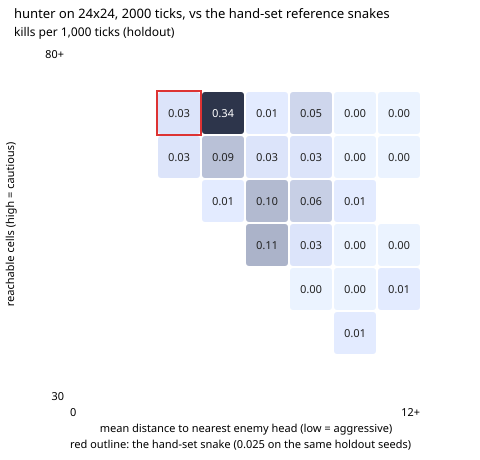

# 2026-11-13 MAP-Elites for the Hunter (plan step 5.2)

**Result: the search found a Hunter that kills far more than the hand-set one.** On 40
holdout seeds the search never saw, the best elite scores **0.338 kills per 1,000 ticks**
against the hand-set Hunter's 0.025: **+0.312, 95% CI [+0.200, +0.438]**. It sits one
cell to the right of the hand-set snake in the grid, slightly less aggressive (mean
distance to the nearest enemy head 4.9 against 4.3) and just as cautious (69 reachable
cells). Two more elites beat the hand-set Hunter with CIs that start at 0: +0.087
[+0.000, +0.175] and +0.075 [+0.000, +0.163]. The others are within noise of it or
below it.

- **Setup:** `arena.cli map-elites hunter --batches 10 --workers 4` with the
  experiment profile (24 × 24 board, 2,000 ticks). The batch size is 16, the first 2
  batches are uniform random (the hand-set Hunter is the first point), and later
  candidates are Gaussian mutations (σ 0.15 in normalised space) of a random elite. Each
  candidate plays 20 dev seeds against the hand-set reference snakes, in the seat the
  seed picks.
- **Grid:** x is the mean Manhattan distance from the head to the nearest enemy head,
  0–12 in 8 bins (low = aggressive). y is the mean number of cells reachable within 6
  steps, 30–80 in 8 bins (high = cautious). Both are the phase 2 behaviour metrics,
  sampled every 10 ticks.
- **Holdout:** at the end, every elite and the hand-set Hunter replayed 40 holdout
  seeds drawn from a disjoint pool, paired by seed, with bootstrap 95% CIs.
  `holdout.json` has every elite's dev score, holdout score, holdout cell and CI.
- **Cost:** 160 candidates × 20 games = 3,200 search games plus 25 × 40 holdout games.
  Run on 4 workers; it was interrupted once by a container restart and resumed from
  `map_elites.json`.

| | Hand-set Hunter | Best elite (cell 3,6) |
|---|---|---|
| Holdout kills / 1k ticks | 0.025 | 0.338 |
| Dev kills / 1k ticks | 0.025 (cell 2,6) | 0.275 |
| Enemy distance, reachable cells (holdout) | 4.3, 69.2 | 4.9, 69.5 |
| `w_head_on_risk` | −40 | +85.7 |
| `w_cut_off` | 12 | 160.1 |
| `w_territory` | 20 | 96.7 |
| `w_space` / `w_space_vs_length` | 6 / 20 | −89.0 / −114.0 |
| `w_straightness` | 0.01 | −10 (the bound) |
| `w_immediate_death` | −1,000 | −3,845 |
| `search_radius` / `pull_radius` | 12 / 0 | 29 / 67 |

The best elite was found in batch 9 (`run.log`). Its holdout score (0.338) is above its dev score
(0.275), so its rank is not just selection luck on the dev seeds. Elites that only
looked good on dev fell back to the hand-set level on holdout, for example cell 5,6
(dev 0.125, holdout 0.050) and cell 7,3 (dev 0.075, holdout 0.000). That is why only
holdout numbers are reported. With 24 elites compared, an interval that starts at 0 is
weak evidence. The +0.312 gap is not.

What this says about the Hunter: the hand-set weights avoid head-on risk and value open
space. The best elite seeks head-on positions, weights cut-offs about 13 times as
heavily, devalues open space and prefers turning, like the Trapper exploiter in
`experiments/2026-11-13-exploiters`. It keeps the hand-set Hunter's caution level while
doing this. These numbers are against the hand-set reference snakes on the
experiment board. Its strength against evolved champions, and on the 100 × 100 board,
was not measured.

This also shows why the phase 4 lineages accepted almost nothing on this board: kills
are rare, and a hill climber's small steps around the hand-set point stay in a flat
region. MAP-Elites' random start batches and archive of distinct behaviours reached a
much better region. The evolve loop does not yet start from MAP-Elites elites.

Files: `map_elites.json` (the archive and per-batch history), `holdout.json`,
`map_elites.svg` and `run.log` (CLI output).
